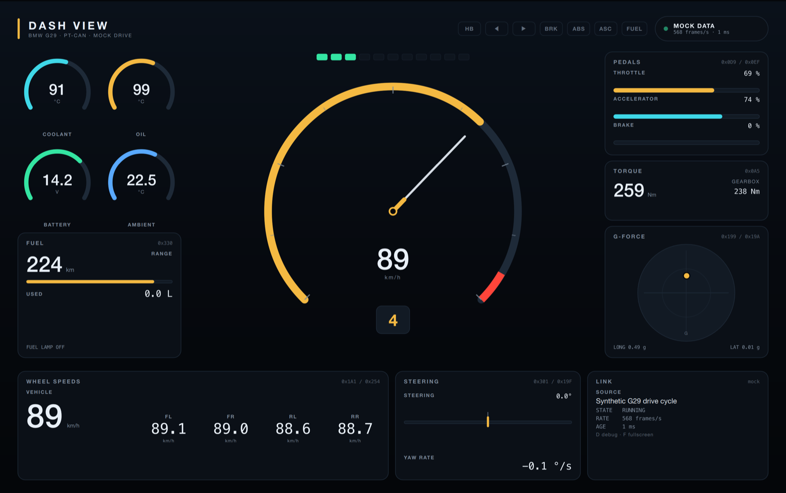
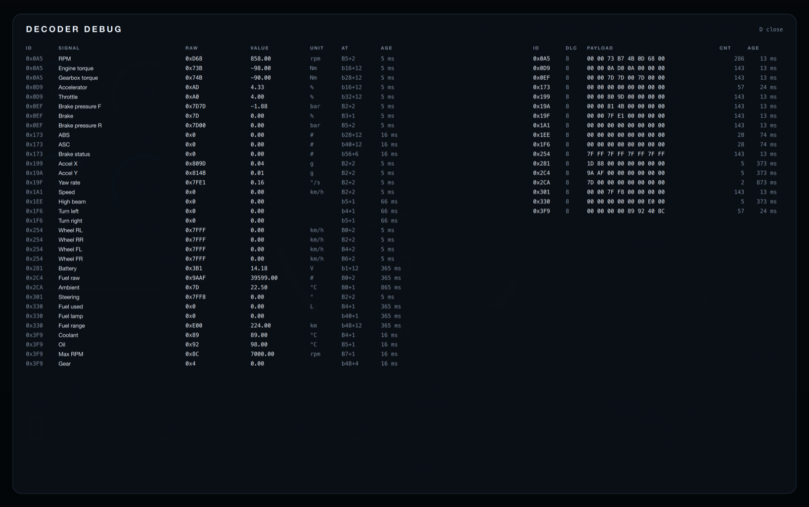

# Dash View

A Qt 6 + QML dashboard for the BMW G29/J29 PT-CAN data map. This build runs on a
**synthetic drive cycle**: it generates real CAN identifiers and payloads, so the
decoder, staleness handling, and UI are exercised end to end without a car.



## What works

- G29/J29 decoder for 33 signals (bit fields, byte fields, scaling and bias).
- Mock source producing frames for `0x0A5`, `0x0D9`, `0x0EF`, `0x173`, `0x199`,
  `0x19A`, `0x19F`, `0x1A1`, `0x1EE`, `0x1F6`, `0x254`, `0x281`, `0x2C4`,
  `0x2CA`, `0x301`, `0x330`, `0x3F9`.
- Dashboard: tach + shift lights + digital speed + gear, temperatures, battery,
  fuel range/used, pedal bars, torque, 4 wheel speeds, steering, G-force,
  telltales, link statistics.
- Decoder debug overlay with per-signal raw/decoded values and a per-ID payload
  table.
- Unit tests for the decoder and the published sample frame.

Not in this build (by design):

- Bluetooth/CAN transport. The firmware lives in a separate project; the proposed
  wire format is documented in [`docs/ble-protocol.md`](docs/ble-protocol.md).
- Log replay/recording.
- Final calibration of a few ambiguous rows. See
  [`docs/signals.md`](docs/signals.md).

## Requirements

- macOS 26+ (the Homebrew Qt 6.12 bottles used here require macOS 26; tested on
  macOS 26.6, Apple Silicon). If you use a Qt built for an older macOS, lower
  `CMAKE_OSX_DEPLOYMENT_TARGET` in `CMakePresets.json` accordingly.
- Xcode Command Line Tools
- CMake 3.24+
- Qt 6.5+ with Qt Quick and Qt Quick Shapes

Qt is available from Homebrew. The lean install is enough:

```sh
brew install qtbase qtdeclarative qtshadertools qtconnectivity
```

The `qtconnectivity` keg is not linked by the app yet; it is installed now so the
future BLE source does not require another Qt setup. Alternatively install the
full `qt` meta formula.

Homebrew's Qt is split across kegs. `CMakePresets.json` points Qt at
`/opt/homebrew`, which is correct for Apple Silicon. On an Intel Mac, replace
`/opt/homebrew` with `/usr/local`.

## Build and run

```sh
cmake --preset macos-debug
cmake --build --preset macos-debug
ctest --preset macos-debug
open build/debug/dash_view.app
```

Or run the binary directly to pass options:

```sh
./build/debug/dash_view.app/Contents/MacOS/dash_view
```

### Options

| Option | Description |
|---|---|
| `--source demo` | Frame source (only `demo` in this build) |
| `--fullscreen` | Start full screen |
| `--debug` | Open the decoder debug overlay on start |
| `--screenshot <file>` | Render the window to a PNG and exit |
| `--screenshot-delay <ms>` | Delay before the screenshot (default 2500) |

Example screenshot at 12 s into the demo, full screen:

```sh
./build/debug/dash_view.app/Contents/MacOS/dash_view \
  --fullscreen --screenshot build/dashboard.png --screenshot-delay 12000
```

### Controls

- **D** — toggle the decoder debug overlay
- **F** — toggle full screen
- **Esc** — close the debug overlay

## Debug overlay



The left table shows every row of the CAN map with its last raw field, decoded
value, field location (`b` = bits, `B` = bytes), and age. The right table shows
the last payload received for each CAN identifier. This is the fastest way to
validate the maps against a real car or a recorded log.

## Project layout

```
CMakeLists.txt / CMakePresets.json
cmake/Info.plist.in            # macOS bundle + Bluetooth usage strings
docs/                          # signal map, wiring, BLE protocol
src/
  main.cpp                     # CLI, app wiring, screenshot mode
  can/
    canframe.h                 # 11-bit CAN frame model
    cansource.h                # abstract frame producer
    democansource.{h,cpp}      # synthetic G29 drive cycle
  decode/
    signaldef.h                # one row of the map
    bmwptcan.cpp               # the 33-row G29/J29 table
    decoder.{h,cpp}            # bit/byte extraction + scaling + inverse
  vehicle/
    vehiclestate.{h,cpp}       # decoded values, staleness, stats, debug data
qml/
  Main.qml                     # window + shortcuts + stage scaling
  Dashboard.qml                # the dashboard layout
  DebugOverlay.qml             # decoder/payload tables
  Theme.qml                    # colors, fonts, formatting helpers
  *.qml                        # gauges, bars, telltales, panels
tests/
  tst_decoder.cpp              # Qt Test suite
```

The design is 1440×900 and is uniformly scaled to the window, so the same layout
works windowed, full screen, or on a dedicated display later.

## How the data flows

```
DemoCanSource ──CanFrame──> Decoder ──> VehicleState ──values──> QML
                                  ▲
                       G29 table (src/decode/bmwptcan.cpp)
```

`VehicleState` decodes at frame rate, coalesces updates to ~30 Hz for QML, and
drops each value after its per-signal timeout. Missing values render as `—`.

The demo source synthesises physical values and runs them through the *inverse*
of the published formulas, so a decoder/scaling mistake shows up as a wrong
dashboard value rather than being hidden.

## Documentation

- [`docs/signals.md`](docs/signals.md) — full map, decode rules, and the rows that
  need real-car validation.
- [`docs/hardware.md`](docs/hardware.md) — PT-CAN tap, termination, power, and
  listen-only notes for the MKR CAN shield.
- [`docs/ble-protocol.md`](docs/ble-protocol.md) — proposed BLE record format and
  rate budget for the separate firmware project.

## Credits

The PT-CAN map and wiring notes come from
[The SECRET Ingredient! — BMW PT-CAN Messages G29/J29](https://thesecretingredient.neocities.org/bmw/can/g29/).
This project is not affiliated with BMW.
